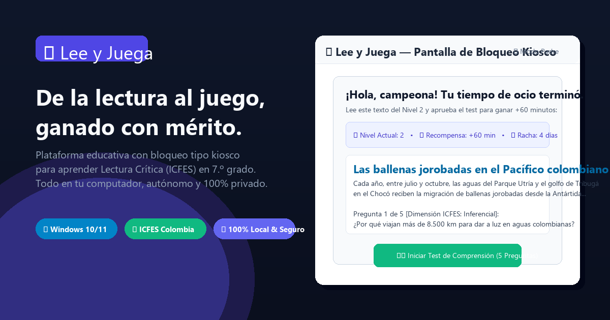
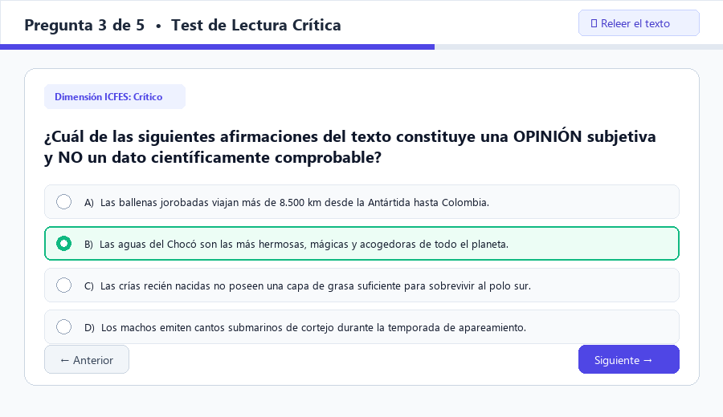
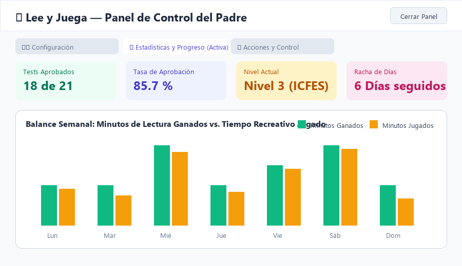

<div align="center">

# 📖 Lee y Juega (Lexia)

**Aprender a leer como exige el ICFES, ganando el tiempo de juego con mérito.**

*Diseñado para estudiantes de 7.º grado (12 años) en Colombia. Cuando el tiempo de ocio se agota, la pantalla kiosco se activa y no permite continuar jugando o viendo videos hasta leer un texto del nivel y aprobar su evaluación de comprensión lectora.*

---

[Características](#-características-principales) • [Pantallas y Flujo](#-capturas-y-flujo-de-la-estudiante) • [Pedagogía ICFES](#-enfoque-pedagógico-icfes) • [Modo Padre](#-modo-padre-y-seguridad) • [Control Parental Windows](#-refuerzo-con-microsoft-family-safety) • [Instalación](#-instalación-y-puesta-en-marcha) • [Arquitectura](#-arquitectura-técnica)

---


-41CD52?style=flat-square&logo=qt)


<br>



</div>

---

## 🌟 Características Principales

* 🔒 **Bloqueo Kiosco Amable y Sin Trampas:** Ventana a pantalla completa, sin bordes y siempre al frente (`WindowStaysOnTopHint`), que impide jugar mientras el saldo de ocio sea cero. No intercepta `Ctrl+Alt+Supr` ni evade antivirus; es seguro, transparente y desinstalable.
* 🧠 **Pedagogía "Enseñar Primero":** Antes de exigir, la app presenta lecciones interactivas cortas con ejemplos visuales para dominar las tres dimensiones de la prueba de Lectura Crítica: **Literal**, **Inferencial** y **Crítico**.
* ⏱️ **Banco de Tiempo de Ocio:** Cada segundo en juegos como *Roblox*, *Minecraft* o redes como *YouTube* y *TikTok* descuenta tiempo del banco. Al llegar a cero, el bloqueo se activa. Aprobar el test recompensa con **+60 minutos** (configurable).
* 🛡️ **Clasificación Inteligente de Ventanas:** Discrimina automáticamente entre actividades de **Ocio** (juegos y redes), actividades de **Estudio** (*Word*, *Google Classroom*, *Wikipedia*, *Khan Academy*, plataformas escolares) que **nunca bloquean**, y tareas neutras.
* 📦 **Banco Offline de +40 Lecturas Curadas:** Funciona de forma autónoma sin depender de internet. Incluye textos literarios (fábulas, mitos muiscas y narraciones colombianas), textos informativos científicos y textos discontinuos (gráficas y tablas con Matplotlib).
* ✨ **Generación Inteligente con Gemini (Opcional):** Si el padre ingresa una clave gratuita de la API de Gemini, la aplicación genera lecturas y cuestionarios en tiempo real adaptados a 7.º grado, guardando la clave cifrada con **DPAPI de Windows**.
* 📈 **Dificultad Adaptativa (Niveles 1 al 6):** El sistema sube de nivel al consolidar rachas aprobadas con honores y disminuye la dificultad de forma empática si la estudiante requiere refuerzo, evitando la frustración.
* 🦉 **Gamificación y Koko el Colibrí:** Medallas coleccionables (*Ojo de Halcón*, *Guardiana de Mitos*, *Cerebro Crítico*), compañero virtual con experiencia/niveles y **Ruleta de Bonificación** al lograr el 100% de aciertos.
* 🖍️ **Herramientas de Lectura Activa:** Subrayador digital multicolor (amarillo, verde, azul), selector de temas visuales (Blanco, Sepia cálido, Noche), **Diccionario Contextual al doble clic** y **Narrador en voz alta (Text-to-Speech)** nativo y offline.
* 📝 **Simulacros y Cuadernillos Imprimibles:** Mini-simulacros Saber 7.° (15 preguntas con cronómetro de 25 min) y generador de cuadernillos imprimibles con **hoja oficial de burbujas** para practicar con lápiz N.° 2.
* 🔐 **Modo Padre con Argon2:** Panel administrativo protegido por hash criptográfico seguro para consultar estadísticas semanales, ajustar minutos manualmente, editar listas de aplicaciones y exportar reportes a CSV.

---

## 📸 Capturas y Flujo de la Estudiante

### 1. El Momento del Bloqueo (Pantalla Kiosco)
Cuando el tiempo de ocio se agota en medio de una partida o un video, la ventana kiosco se eleva suavemente sobre todas las aplicaciones:
* Saludo motivador con tono de entrenador (*"¡Vamos a leer para jugar!"*).
* Indicador del **Nivel Actual**, la **Racha de Días** y los **Minutos a Ganar**.
* Si es la primera vez que se enfrenta a una dimensión lectora, se abre una micro-lección guiada con ejemplos y consejos prácticos.

### 2. Evaluación de Lectura Crítica con Tutor Interactivo
<div align="center">
  
  <p><i>Cuestionario de opción múltiple estructurado bajo los estándares del ICFES con distinción de niveles de comprensión.</i></p>
</div>

* 5 a 8 preguntas con una única respuesta correcta y 4 opciones balanceadas.
* Posibilidad de releer el texto completo en cualquier instante.
* **Tutor Pedagógico:** Si el test se reprueba, el tutor explica pregunta por pregunta *por qué la respuesta correcta lo es* y *qué pista debió observarse*, ofreciendo de inmediato otra lectura fresca para intentarlo de nuevo sin castigos.

### 3. Panel de Control del Modo Padre
<div align="center">
  
  <p><i>Panel con estadísticas detalladas, gráficas de lectura vs. ocio con Matplotlib y controles inmediatos.</i></p>
</div>

---

## 🎯 Enfoque Pedagógico ICFES

La aplicación sigue fielmente la matriz de competencias de la prueba de **Lectura Crítica del ICFES** (Saber 11 y evaluaciones diagnósticas de básica secundaria):

| Dimensión ICFES | Qué Evalúa | Pregunta Típica en Lee y Juega |
|---|---|---|
| **Literal** | Identificar y entender los contenidos locales y datos explícitos del texto. | *¿Qué prenda llevaba el personaje al salir de casa?* / *¿Dónde se ubica el arrecife?* |
| **Inferencial** | Comprender cómo se articulan las partes de un texto para darle un sentido global; deducir intenciones. | *¿Por qué el autor compara al colibrí con un helicóptero?* / *¿Qué emoción siente el personaje?* |
| **Crítico** | Reflexionar a partir de un texto y evaluar su contenido, distinguiendo hechos de opiniones y evaluando argumentos. | *¿Cuál de los enunciados es una opinión subjetiva y no un dato medible?* / *¿Qué debilita la tesis?* |

---

## 🛡️ Modo Padre y Seguridad

El Modo Padre permite configurar el entorno de forma sencilla y transparente:

```
[Bandeja de Windows / Botón Kiosco] ──> [Diálogo Clave Argon2] ──> [Panel Padre]
                                                                        ├── ⚙️ Parámetros y Listas
                                                                        ├── 📊 Métricas y Gráficas
                                                                        └── ⚡ Acciones Inmediatas
```

* **Cifrado de Secretos con DPAPI (`win32crypt`):** La API key de Gemini nunca se guarda en texto plano en archivos JSON ni en el código; se delega a las APIs nativas de Windows vinculadas a la sesión del usuario.
* **Hash de Contraseña con Argon2 (`argon2-cffi`):** Resistencia probada contra ataques de fuerza bruta y diccionario.
* **Icono Dinámico en la Bandeja:** Muestra en tiempo real un distintivo numérico con los minutos restantes y cambia de verde a ámbar y rojo.

---

## 👨‍👩‍👧 Refuerzo con Microsoft Family Safety

> [!IMPORTANT]
> **Honestidad sobre el Bloqueo Kiosco:**
> La app bloquea `Alt+F4`, carece de botones de cerrar y se re-eleva automáticamente. Sin embargo, respetando las políticas de seguridad de Windows, **no bloquea `Ctrl+Alt+Supr` ni oculta su proceso del Administrador de tareas**. 
> Por ello, la estrategia definitiva consiste en **combinar "Lee y Juega" con Microsoft Family Safety**.

### Cómo configurarlo en 3 pasos:

1. **Cuenta Infantil en Windows:** Convierte la cuenta de la niña en una cuenta estándar (no administradora) vinculada a tu grupo de [Microsoft Family Safety](https://family.microsoft.com).
2. **Límites de Tiempo Base en Cero:** En la app Family Safety de tu celular, establece el límite diario de tiempo de pantalla o de juegos como *Roblox* en 0 horas por defecto.
3. **El Dúo Perfecto:**
   * **Family Safety** asegura el cerrojo a nivel del núcleo del sistema (cerrar la app no devuelve los juegos).
   * **Lee y Juega** ofrece la vía autónoma, educativa y divertida para ganarse ese tiempo mediante el estudio y la lectura comprensiva.

---

## 🚀 Instalación y Puesta en Marcha

### Requisitos
* Windows 10 o Windows 11 (64-bit).
* Python 3.12 instalado (recomendado) o el instalador ejecutable `.exe`.

### Opción 1: Ejecución directa desde el repositorio

1. Clonar el repositorio:
   ```bash
   git clone https://github.com/TU_USUARIO/Lexia.git
   cd Lexia
   ```

2. Crear y activar entorno virtual (opcional pero recomendado):
   ```powershell
   python -m venv venv
   .\venv\Scripts\Activate.ps1
   ```

3. Instalar dependencias:
   ```powershell
   pip install -r requirements.txt
   ```

4. Iniciar la aplicación:
   ```powershell
   python run.py
   ```

### Opción 2: Compilar el instalador para Windows (.exe)

El repositorio incluye los scripts listos para generar el ejecutable autónomo y el instalador wizard:

1. Compilar con **PyInstaller**:
   ```cmd
   instalador\compilar_exe.bat
   ```
2. Compilar el instalador con **Inno Setup**:
   * Abrir `instalador\instalador.iss` con Inno Setup Compiler y presionar `F9`.
   * El instalador generado se ubicará en `Output\Instalador_Lee_y_Juega_v1.0.exe`.

---

## 🏛 Arquitectura Técnica

```
c:\logula\APP_CLAUDE\Lexia\
├── docs/                      # Manual del padre, especificación y progreso
│   ├── MANUAL_PADRE.md        # Guía paso a paso de control parental
│   ├── ESPECIFICACION.md      # Especificación completa del sistema
│   └── PROGRESO.md            # Registro de cumplimiento de fases
├── assets/                    # Capturas y elementos visuales del README
├── lee_y_juega/
│   ├── app/
│   │   ├── main.py            # Orquestador general (Bandeja + Monitor + Kiosco)
│   │   ├── bloqueo/           # Ventana Kiosco frameless siempre al frente
│   │   ├── config/            # Configuración JSON y cifrado DPAPI (win32crypt)
│   │   ├── datos/             # Base de datos local SQLite con SQLAlchemy
│   │   ├── lectura/           # Catálogo de 40+ lecturas, textos discontinuos y Gemini
│   │   ├── nucleo/            # Monitor psutil/win32, banco de tiempo y vigilante
│   │   ├── pedagogia/         # Lecciones interactivas previas y tutor empático
│   │   └── ui/                # Temas QSS, System Tray y panel Modo Padre
│   └── recursos/              # Banco offline de lecturas y preguntas
├── instalador/                # Scripts Inno Setup e instalador por lotes
├── tests/                     # Suite completa de pruebas automatizadas
├── requirements.txt           # Dependencias de Python
└── run.py                     # Punto de entrada raíz
```

---

## 🧪 Pruebas Automatizadas

El proyecto cuenta con cobertura de pruebas unitarias y de integración para garantizar estabilidad y confiabilidad:

```powershell
pytest -v
```

Módulos evaluados:
* `test_banco_offline.py`: Verifica la integridad y estructura de las 40+ lecturas con sus 5 preguntas y 3 dimensiones.
* `test_banco_tiempo.py`: Valida el cómputo de saldo, suma de recompensas y control de horarios.
* `test_calificacion.py`: Evalúa cálculo porcentual, umbrales y desglose literal/inferencial/crítico.
* `test_dificultad.py`: Comprueba las transiciones adaptativas entre los niveles 1 al 6.
* `test_limpieza.py`: Valida filtros heurísticos de protección infantil y saneamiento de textos.
* `test_monitor_actividad.py`: Prueba la clasificación exacta de Ocio, Estudio y Neutro.
* `test_repositorio.py`: Verifica persistencia SQLite, modelos SQLAlchemy y exportación a CSV.

---

## 📄 Licencia y Uso Ético

Este software es de **código abierto y de uso libre**, concebido con fines exclusivamente educativos y de acompañamiento familiar positivo. Respeta plenamente la privacidad de los menores: **todas las estadísticas y registros se almacenan 100% de manera local en el computador**.
